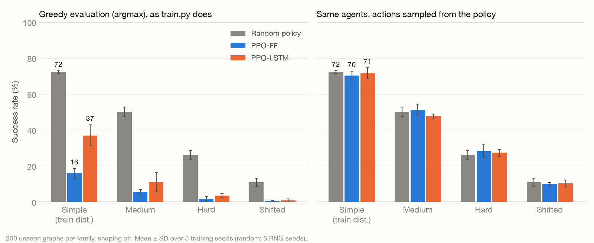
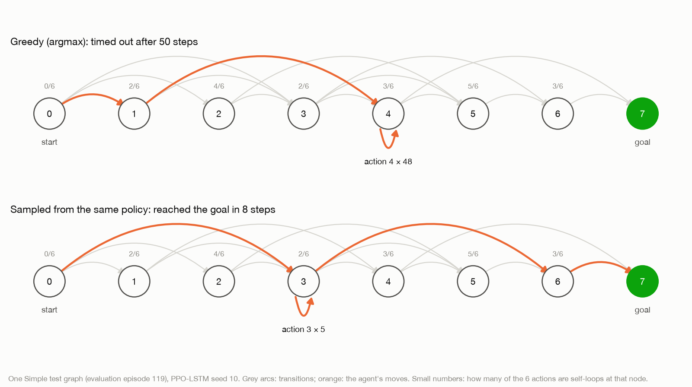

# Flow navigation RL

Tabular Q-learning and PPO agents (feed-forward and LSTM) learning to reach a goal node in small, randomly generated directed graphs, a toy stand-in for moving through an app's screens, where random "popups" sometimes swallow the chosen action.



On unseen graphs from the training distribution, a uniform-random policy reaches the goal 72% of the time. My PPO-LSTM reaches it 37% of the time and PPO-FF 16%, when evaluated greedily as `train.py` does. Sampling actions from the same trained policies gives 71% and 70%. So neither agent beats random, and greedy decoding makes them much worse than random. The rest of this README explains why.

## Results

Success rate (%) over 200 unseen graphs per family, with reward shaping off. The PPO rows are the mean ± SD over 5 training seeds (10, 20, 30, 40, 50).

| Policy | Simple (training distribution) | Medium | Hard | Shifted |
|---|---|---|---|---|
| Uniform random (5 RNG seeds) | 72 ± 1 | 50 ± 3 | 26 ± 3 | 11 ± 2 |
| PPO-FF, greedy | 16 ± 3 | 6 ± 1 | 2 ± 1 | <1 |
| PPO-FF, sampled | 70 ± 3 | 51 ± 3 | 28 ± 4 | 10 ± 1 |
| PPO-LSTM, greedy | 37 ± 6 | 11 ± 5 | 3 ± 1 | 1 ± 1 |
| PPO-LSTM, sampled | 71 ± 3 | 48 ± 1 | 27 ± 2 | 10 ± 2 |
| Oracle that reads the hidden graph (reference, not an agent) | 97 | 87 | 69 | 48 |

How I measured it:

- Every row uses `evaluate()` from `train.py` unchanged: 200 graphs from `EnvGen(42)`, evaluation seed 3000, shaping off, success meaning the goal was reached within the step budget.
- Each PPO agent is trained exactly as in step 2 of `train.py` (`train_ppo_distribution`, 1,800 episodes). My harness also seeds torch, which `train.py` doesn't, so these runs are repeatable.
- "Sampled" calls the same trained agent with `explore=True`. Nothing else changes.
- The oracle cheats: it looks at the true transitions and avoids failure nodes. It shows how much of the gap comes from information the agents never see.
- The harness that produced this table is a short script around `train.py`'s own functions, and it isn't in the repo.

A plain `train.py` run gives numbers in the same range. Over four runs, PPO-LSTM's greedy success on Simple was 27–43% and PPO-FF's was 14–22%. The committed `results/` folder, from the original run, shows 35% and 13%.

### Why greedy evaluation does worse than random



At each node, every one of the 6 actions leads to a random node one to three steps ahead, or stays where it is. Across 2,000 Simple graphs, 36% of actions at non-goal nodes were self-loops. Nothing in the observation says which action does what, because those mappings are redrawn for every node of every graph. Across graphs, no action label is better than another, so the best a policy can do from what it sees is to keep trying actions until one moves it on.

Training pushes both policies towards roughly that: their success under sampling matches random's. Greedy evaluation then takes the argmax of a near-uniform distribution. When that action is a self-loop, the next observation is almost identical, so the agent picks the same action again until the episode times out. In the episode above, greedy PPO-LSTM sits at node 4 pressing action 4 for 48 steps, while actions 3 and 5 lead straight to the goal. Greedy PPO-FF episodes average 37 of 50 steps, against 7.5 for random, and its success is about the same as always pressing action 0 (15%).

PPO-LSTM loses less to greedy decoding than PPO-FF. Under sampling, though, the two are equal. My best guess, which I haven't tested, is that the changing hidden state sometimes flips the argmax and gets the LSTM out of a loop. It isn't evidence that memory helps here.

### Single fixed graph (step 1 of `train.py`)

`train.py` also trains each agent for 300 episodes on one fixed Medium graph, with exploration and shaping on. The figures below are success over the last 50 training episodes, across four runs of `train.py`.

| Agent | Last-50 training success |
|---|---|
| Uniform random (same loop, one run) | 80% |
| Tabular Q-learning, node id as state | 76% in every run (numpy only, so deterministic) |
| PPO-FF | 80–88% |
| PPO-LSTM | 74–98% |

The tabular agent is held back by a bug: it updates the state after the step instead of the one it acted in (see Limitations). PPO's spread comes from torch not being seeded.

## Run it

```bash
uv sync
MPLBACKEND=Agg uv run python train.py
```

This runs all three steps: the fixed-graph comparison, PPO training on Simple graphs, and evaluation on all four families. It writes JSON and plots to `results/`, overwriting the committed ones. `train.py` calls `plt.show()` after each plot. Without `MPLBACKEND=Agg`, the run stops at each plot window until you close it.

It runs on CPU and took 24–51 s per run (four runs) on an Apple M6 with 12 cores and 32 GB of RAM, which was shared with other jobs at the time. Python 3.14, torch 2.15, numpy 2.5.

## How it works

The code is three files: `env.py` (graph world), `agents.py` (tabular Q and PPO) and `train.py` (training, evaluation, plots).

The environment (`FlowEnv`):

- A graph has 8–20 nodes, and each node has 6 actions. Each action moves forward 1–3 nodes with probability 0.7, and otherwise stays put. There are no backward edges.
- The last node is the goal (+1, episode ends). Any other node is a failure node (−1, episode ends) with probability `fail_p`. The generator also flags "dead ends", but a later step gives every non-goal node at least one forward edge, so none of them is actually a dead end.
- With probability `popup_p`, a step is a popup: the action is ignored and the reward is −0.5.
- Otherwise the reward is −0.02 per step, plus 0.10 for reaching a node for the first time.
- The observation has 13 numbers: 10 random binary features fixed per node (unrelated to where the actions go), the fraction of nodes visited, the fraction of the step budget used, and φ. φ is 1 − d/d_max, where d is the node's shortest-path distance to the goal in the true graph. The agent never sees the node id, which actions loop, or which nodes are failures.
- During training only, the reward gets an extra shaping term, 0.35·(φ(s′) − φ(s)) (0.2 on the fixed graph). It is switched off for evaluation.

The four test families each change a few settings:

| Family | Nodes | Popup prob. | Failure prob. | Step budget |
|---|---|---|---|---|
| Simple | 8 | 0.05 | 0.10 | 50 |
| Medium | 12 | 0.10 | 0.12 | 60 |
| Hard | 16 | 0.15 | 0.15 | 70 |
| Shifted | 20 | 0.25 | 0.20 | 90 |

The agents:

- Tabular Q-learning uses the node id as the state, so it only makes sense on a single fixed graph.
- PPO-FF is a two-layer, 128-unit actor-critic. It uses GAE (γ 0.99, λ 0.95), clip 0.15, and an entropy bonus annealed from 0.05 to 0.005.
- PPO-LSTM puts a 128-unit LSTM after a linear embedding and trains on whole episodes, starting each from a zero hidden state.
- Both PPO agents train for 1,800 episodes on freshly generated graphs. The first 600 come from an easier Simple generator, with fewer popups and failures.

`design_note.md` is a short note from the first version on how this setup might map to automated testing of real apps.

## How this evolved

The first version, from October 2025, reported no numbers and had no baseline, so I didn't notice the agents scoring below random. Its README also claimed that popups made the problem partially observable, and that the LSTM was there to handle it. In November 2026 I added the random baseline, the oracle and the sampled evaluation above, all measured on the unchanged code. They show that the gap between PPO-LSTM and PPO-FF in the committed results comes from greedy evaluation.

## Limitations and next steps

Known problems in the code as it stands:

- Tabular Q-learning updates the wrong state (`train.py:36-39`). `agent.update(env.s, a, r, env.s, done)` runs after `env.step`, so it updates the next state's value. In a scratch copy with the state captured before the step, tabular reaches 100% over the last 50 episodes on the fixed graph, against 76%. That reverses the fixed-graph ranking.
- PPO stores the observation after each step alongside that step's action, log-probability and value (`train.py:82-83`, `146-147`). In a scratch copy with this fixed, plus episodes that hit the step limit treated as ended and torch seeded, the picture doesn't change: over 5 seeds, PPO-LSTM got 41 ± 6% greedy and 70 ± 2% sampled on Simple.
- Torch is never seeded, so `train.py` gives different PPO numbers on every run.
- The evaluation isn't paired. `train.py` evaluates PPO-FF with seed 3000 and PPO-LSTM with seed 4000. Graphs are generated after the previous episode has used up random numbers, so two policies don't see exactly the same test graphs.
- The shaping isn't strictly potential-based: it has no γ, and it is dropped on terminal steps. φ is also part of the observation, which hands the agent information from the true graph.

What I'd do next:

1. Fix the bugs above, pre-generate the test graphs, and report greedy and sampled results with a random baseline as part of `train.py`.
2. Make the task learnable from observations, for example with noisy per-action hints in place of φ. Then check whether PPO-LSTM can beat random once there is something to learn.
3. Compare against an off-the-shelf recurrent PPO (Stable-Baselines3 `RecurrentPPO`) and a small local LLM agent given the same observations.

## Credits

- PPO: Schulman et al., "Proximal Policy Optimization Algorithms" (2017). GAE: Schulman et al., "High-Dimensional Continuous Control Using Generalized Advantage Estimation" (2015). Potential-based shaping: Ng, Harada and Russell, "Policy invariance under reward transformations" (1999).
- Built with PyTorch (BSD-3-Clause), NumPy (BSD-3-Clause), Matplotlib (Matplotlib licence, BSD-style) and tqdm (MPL-2.0 and MIT).
- Code: MIT, see `LICENSE`.
